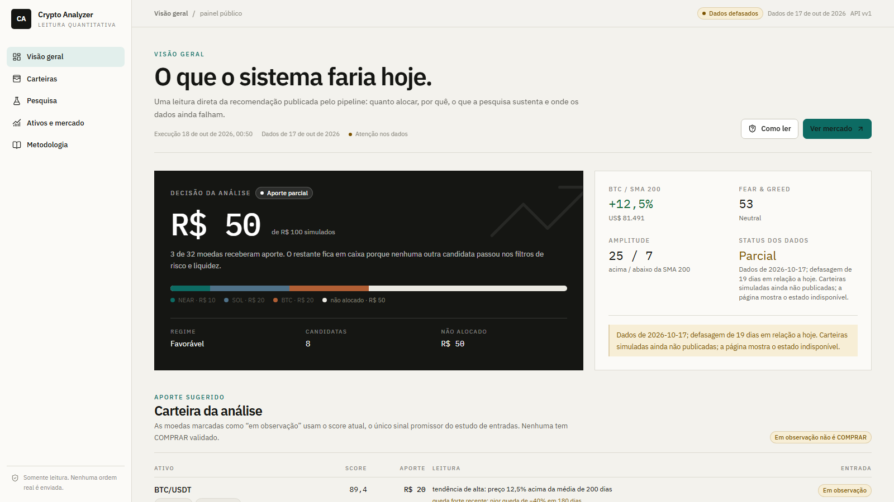
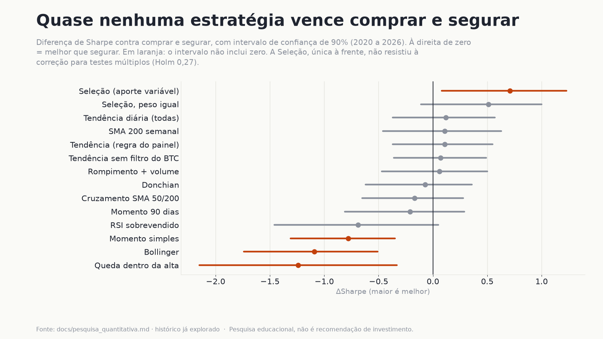
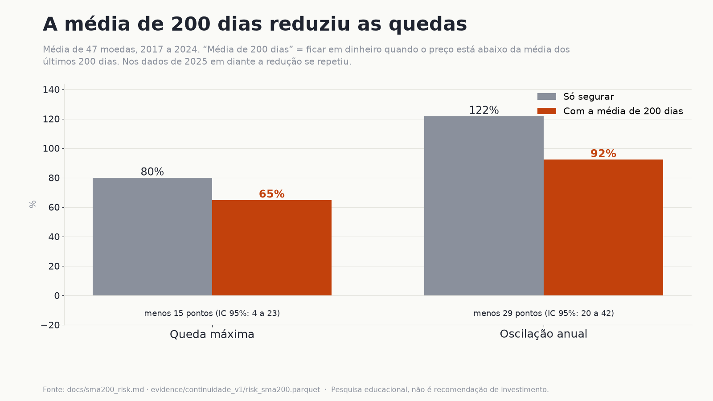
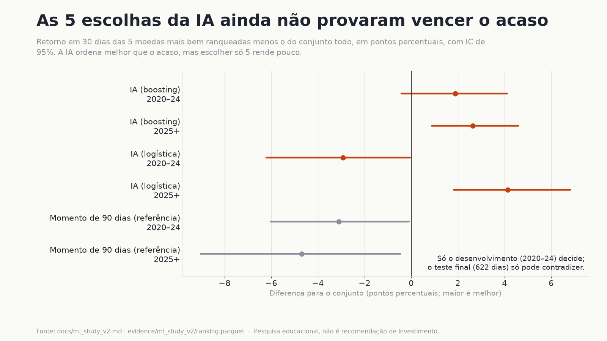
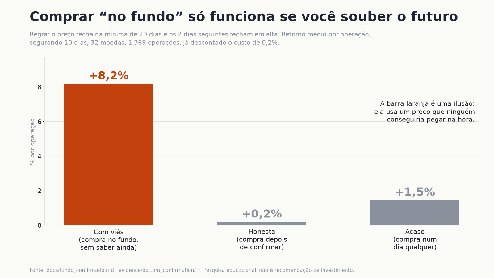
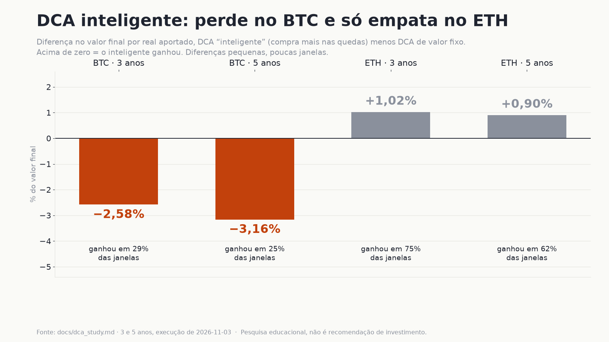

# Crypto Analyzer

[](https://github.com/samuelmel/cripto-analysis/actions/workflows/ci.yml)
[](LICENSE)

Pipeline em Python que testa, com método estatístico, se dá para vencer o "comprar e segurar" em criptomoedas, e mostra
os resultados num painel web e num resumo diário no Telegram. O achado central é honesto: **quase nada vence comprar e
segurar**, e o projeto existe para mostrar o que não funciona e por quê.



> **Aviso:** projeto experimental e educacional. Não executa ordens em corretoras e não é recomendação financeira.
> Resultados históricos não garantem desempenho futuro.

## Principais achados

Todos os estudos têm o protocolo escrito **antes** de rodar, comparam com "comprar e segurar" ou com o acaso, usam
intervalos de confiança por bootstrap e corrigem para múltiplos testes. Os períodos de 2023 em diante já foram
consultados durante o desenvolvimento, então tudo é **exploratório**.

1. **Quase nenhuma estratégia vence comprar e segurar.** De 14 regras testadas (tendência, rompimento, momento, RSI,
   Bollinger, seleção de moedas), nenhuma mostrou vantagem confirmada depois da correção para testes múltiplos; três
   foram significativamente piores. [Detalhes](docs/pesquisa_quantitativa.md)

   

2. **A média de 200 dias reduz as quedas.** Ficar em dinheiro quando o preço está abaixo da média de 200 dias baixou a
   queda máxima média de 80% para 65% e a oscilação de 122% para 92% (47 moedas, 2017–2024), e o resultado se repetiu
   em 2025+. [Detalhes](docs/sma200_risk.md)

   

3. **A IA ainda não provou vencer o acaso.** Os modelos ordenam as moedas um pouco melhor que o acaso, mas as 5 escolhas
   deles não superaram o conjunto de forma confiável no desenvolvimento. Por isso ela continua em teste, só
   opinando. [Detalhes](docs/ml_study_v2.md)

   

4. **"Comprar no fundo" só funciona se você souber o futuro.** A regra "fundo de 20 dias confirmado por 2 candles em
   alta" rende +8,2% por operação quando se compra no preço do fundo, mas só +0,2% quando se compra depois da
   confirmação, abaixo dos +1,5% de comprar num dia qualquer. [Detalhes](docs/fundo_confirmado.md)

   

5. **DCA "inteligente" não bate o DCA fixo.** Comprar mais nas quedas perdeu no BTC (−2,6% a −3,2% no valor final por
   real aportado) e só empatou no ETH, com poucas janelas. [Detalhes](docs/dca_study.md)

   

Também testado e encerrado: o gráfico Renko (21% a 43% das regras bateram comprar e segurar; o critério era 50%),
[em docs/renko_estudo.md](docs/renko_estudo.md). As imagens são geradas por `research/make_figures.py`.

## Como funciona

```
Fontes de mercado
      │
      ▼
Ingestão e validação
      │
      ▼
Dados históricos (Parquet)
      │
      ▼
Indicadores e sinais
      │
      ▼
Backtesting e análise de risco
      │
      ├──► API somente leitura ──► Painel web
      └──► Resumo no Telegram
```

O pipeline Python concentra a coleta e a análise. A API FastAPI lê os Parquets publicados e o frontend React consome essa
API; nenhum dos dois calcula recomendações de forma independente nem envia ordens. A regra de negócio é função pura em
`src/transformers/`; rede e disco ficam só nas bordas (extratores, loaders, notificadores e entrypoints).

Tecnologias: Python 3.12+, pandas, NumPy, PyArrow (Parquet), React, TypeScript, Vite, Tailwind CSS, pytest, mypy
(`--strict`) e uv.

## Como rodar

Requisitos: Python 3.12+, [uv](https://docs.astral.sh/uv/), Node.js 20+ e pnpm 10 (via `npx`), internet para atualizar
os dados.

```bash
uv sync
cd frontend && npx --yes pnpm@10 install && cd ..
```

```bash
uv run python -m src.pipeline            # atualiza os dados e roda a análise
uv run python -m src.pipeline --offline  # só com dados locais
uv run python -m src.pipeline --dry-run  # mostra a mensagem do Telegram sem enviar
uv run run.py                            # sobe API e painel e abre o navegador
```

Variações do atalho: `--no-browser`, `--prod` (serve o build em :8000) e `--prod --build` (gera o build antes).
O modo padrão usa Vite em http://localhost:5173 com proxy para a API em :8000.

**Telegram (opcional):** defina as variáveis de ambiente `TELEGRAM_BOT_TOKEN` e `TELEGRAM_CHAT_ID`. Nunca coloque tokens
ou chaves no código, em arquivos versionados ou em logs. `COINGECKO_API_KEY` é opcional e aumenta o limite do CoinGecko.

**Testes e qualidade:**

```bash
uv run pytest
uv run mypy --strict src/ mcp_server.py run.py
uv lock --check
cd frontend && npx --yes pnpm@10 typecheck && npx --yes pnpm@10 test && npx --yes pnpm@10 build
```

As configurações principais (universo de moedas, filtros, orçamento simulado e premissas de custo) ficam em
`src/config.py`.

## Rodando no seu fork

O pipeline diário grava o estado (posições, registro de sinais, avisos) num repositório privado separado,
`samuelmel/cripto-analysis-state`, com acesso por deploy key no secret `STATE_DEPLOY_KEY`. Sem esse secret e sem um repositório de
estado próprio, o pipeline diário falha logo no início com uma mensagem clara. O restante (CI, pesquisa, painel local) funciona sem
segredo. Para configurar o seu, veja [docs/state.md](docs/state.md).

## Limitações

- O mercado de criptomoedas é volátil; perdas substanciais são possíveis.
- Backtests dependem das premissas de execução, dos custos e da qualidade dos dados; spread e slippage são estimados.
- Há viés de sobrevivência no universo de moedas e uma única história de mercado, com poucos ciclos.
- Os resultados são exploratórios: não provam vantagem estatística nem garantem rentabilidade.
- O projeto não envia ordens para corretoras.

## Estrutura do projeto

```
run.py               # atalho para subir API e painel
src/
  api/               # API FastAPI somente leitura para o painel
  extractors/        # adaptadores das fontes de dados
  transformers/      # indicadores, sinais, seleção e backtesting (funções puras)
  loaders/           # persistência e leitura de dados
  notifiers/         # envio de notificações (Telegram)
  pipeline.py        # orquestração da execução
  config.py          # configuração
research/            # estudos quantitativos e geração das figuras
evidence/            # resultados dos estudos (Parquet)
frontend/            # painel React/TypeScript
tests/               # testes automatizados
docs/                # metodologia, arquitetura e estudos
```

Mais detalhes em [docs/](docs/): [pesquisa quantitativa](docs/pesquisa_quantitativa.md),
[validação de sinais](docs/signal_validation.md) e [sinais de entrada](docs/entry_signals.md) (nenhum sinal validado,
então nenhuma moeda mostra COMPRAR).

## Licença

[MIT](LICENSE).
