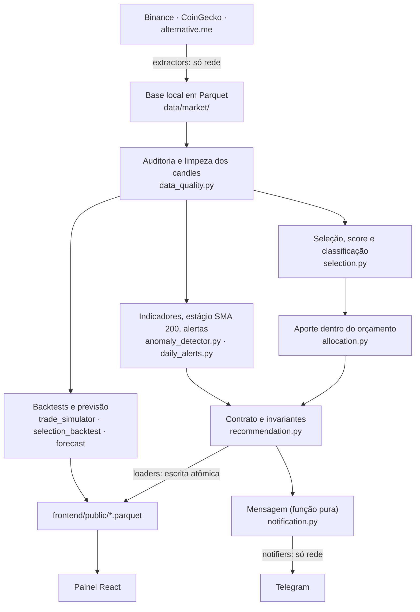

# Arquitetura

Como os dados entram, são transformados e chegam ao painel e ao Telegram. As regras que sustentam esta organização estão em [CLAUDE.md](../CLAUDE.md).

## Fluxo de dados



Em texto: `src/pipeline.py` atualiza a base (`update_base`), analisa tudo sem rede (`analyze`), imprime o relatório e, se pedido, formata e envia a mensagem. O painel e o Telegram **só leem** o resultado. Nenhum dos dois recalcula score ou aporte.

## Camadas

| Pasta | Papel | Pode fazer I/O? |
|---|---|---|
| `src/extractors/` | Um adaptador por fonte, com saída padronizada | Só em `fetch` (rede). `to_frame` e `standardize` são puros. |
| `src/transformers/` | Regras de negócio: indicadores, seleção, aporte, backtests, previsão, formatação da mensagem | **Não.** Funções puras: DataFrames entram e DataFrames saem. A data de referência é parâmetro. |
| `src/loaders/` | Gravação em Parquet com escrita atômica (`.tmp` → `replace`) | Só disco |
| `src/notifiers/` | Envio da mensagem ao Telegram | Só rede. O token nunca aparece em log, mensagem ou exceção. |
| `src/pipeline.py`, `src/positions.py`, `mcp_server.py` | Entrypoints: orquestram e injetam parâmetros (data, orçamento, credenciais) | Sim |
| `frontend/src/data/` | Leitura e validação do Parquet (`loadSignals.ts`), cálculos e textos puros | Só o módulo de carregamento faz `fetch` |
| `frontend/src/components/` | Componentes React | Não fazem `fetch` |

Os parâmetros ficam em `src/config.py` e chegam às regras por dataclasses (`UniverseRules`, `SelectionRules`, `AllocationRules`), com esses valores como padrão.

## Fontes de dados

| Fonte | O que traz | Chamada | Onde fica |
|---|---|---|---|
| Binance | Candles diários de preço e volume (a única fonte de preço) | `GET /api/v3/klines`, uma moeda por vez, até 1000 candles por página. O candle ainda aberto é descartado. | `data/market/ohlcv_1d/symbol=…/data.parquet` (upsert por moeda e dia) |
| CoinGecko | Valor de mercado e volume atuais, uma foto por execução | `GET /coins/markets`, uma chamada para todas. A chave Demo opcional vai no header `x-cg-demo-api-key`. | `data/market/coingecko/data.parquet` |
| alternative.me | Fear & Greed diário (só alimenta o aviso de pânico) | `GET /fng/` | `data/market/fng/data.parquet` |
| (registro) | Quando cada fonte foi atualizada, com status e erro | Gravado a cada atualização | `data/market/source_log/data.parquet` |

A Binance aceita dois hosts: `https://api.binance.com` (padrão) e `https://data-api.binance.vision`, que é escolhido pela variável `BINANCE_API_HOST`. Qualquer outro valor é recusado.

## Garantias de qualidade

- **Rede.** Timeout de 30 s por tentativa e no máximo 5 tentativas, com espera de 2, 4, 8 e 16 s. `Retry-After` é respeitado em 429/418, e um ban longo desiste na hora. Há espaçamento mínimo entre chamadas por fonte: 0,2 s na Binance e 1 s no CoinGecko e no alternative.me. O plano Demo do CoinGecko permite 100 chamadas por minuto e 10 mil por mês, e o pipeline usa uma por execução.
- **Resposta incompleta ou fora do formato.** JSON inválido, campos faltando ou candle curto viram `ExtractorError`. Nunca viram dado silenciosamente errado.
- **Fonte secundária fora do ar** (CoinGecko ou Fear & Greed) não derruba o pipeline. O valor de mercado fica nulo e o aviso de pânico não dispara.
- **Fonte primária fora do ar** (Binance) para uma moeda: o erro é registrado e a análise segue com a base local. A moeda sem candle recente fica INDISPONÍVEL.
- **Fornecedores não se misturam.** Se chegarem candles de outra fonte para uma moeda que já tem base, a gravação é recusada (`MixedSourceError`).
- **Auditoria dos candles** a cada execução, que aparece no relatório. Ela procura duplicados, dados fora de ordem, preço nulo, NaN, infinito ou ≤ 0, fontes misturadas e lacunas de dias. Preço inválido e duplicados são descartados antes dos indicadores.
- **Dado desatualizado nunca gera sinal atual.** O último candle fechado esperado é o de ontem (UTC). A moeda fica `INDISPONÍVEL`, com o motivo em `stage_reason`, sem alertas e sem pânico, em três casos: atraso maior que `MAX_STALE_DAYS`, menos de 200 dias de histórico ou BTC indisponível. As posições dessa moeda também ficam indisponíveis, a menos que o STOP já tenha disparado.
- **Recomendação consistente.** `validate_recommendation` confere o orçamento, as moedas com valor e o `run_ts` antes de gravar. Se algo falhar, nada é publicado.

## Arquivos gerados

Todos são Parquet. Os de `frontend/public/` usam compressão snappy e estão fora do Git.

| Arquivo em `frontend/public/` | Conteúdo |
|---|---|
| `daily_signals.parquet` | Uma linha por moeda: estágio SMA 200, alertas, score, componentes, classificação, motivos, riscos e aporte. **Gravado por último**: é o estado final da execução. |
| `recommendation.parquet` | Resumo em uma linha: orçamento, mercado, total sugerido, saldo, notas, evidência e estado dos dados |
| `selection_backtest.parquet` | Seleção contra as referências simples, com custos, em treino, validação e teste |
| `market_regimes.parquet` | Regime de mercado do BTC por dia (tendência e volatilidade), causal e versionado. Só descrição: não alimenta nenhuma regra. Ver [regimes.md](regimes.md) |
| `history.parquet` | Preço, indicadores (SMA 90 e 200, RSI, z-score) e estágio de todos os dias |
| `backtest.parquet` | Cada operação simulada da regra de tendência (BTC e ETH) |
| `performance.parquet` | Carteira: tendência, comprar e segurar e pânico, em treino e teste |
| `forecast.parquet` | Previsão de 1, 7 e 30 dias de BTC e ETH, com a avaliação contra a referência |
| `sources.parquet` | Quando e como cada fonte foi atualizada |
| `strategy_lab.parquet` | Resultados do laboratório (opcional, vem de `research/strategy_lab.py`) |
| `positions.parquet`, `closed_positions.parquet` | Suas posições abertas com a recomendação, e as vendas registradas |

| Pasta em `data/` (fora do Git) | Conteúdo |
|---|---|
| `data/market/` | Base histórica e registro de fontes |
| `data/signals/history/` | Snapshot diário dos sinais |
| `data/state/` | Estado persistente (worktree da branch `state`): posições, registro de sinais, estados e avisos |
| `data/research/` | Saídas dos estudos (`strategy_lab*.parquet`, `selection_study.parquet`) |

O tipo de uma linha de `daily_signals.parquet` (e dos demais arquivos) é declarado em um único módulo TypeScript, [`frontend/src/types/signals.ts`](../frontend/src/types/signals.ts), que espelha o schema do Python.

## Estrutura detalhada

```
src/
  pipeline.py              orquestra: atualiza base → analisa → compara com ontem → publica → notifica
  positions.py             CLI das suas posições
  config.py                universo, seleção, orçamento, qualidade de dados e períodos de backtest
  extractors/
    binance_adapter.py       candles 1d (/api/v3/klines), hosts permitidos
    coingecko_adapter.py     valor de mercado atual (/coins/markets)
    fng_adapter.py           Fear & Greed (alternative.me)
    http.py                  timeout, retry e espaçamento entre chamadas
  transformers/
    universe.py              quem entra na análise (exclusões, histórico, volume)
    data_quality.py          auditoria dos candles e disponibilidade (INDISPONÍVEL)
    anomaly_detector.py      SMA 200, tendência, estágio e alerta de pânico
    daily_alerts.py          alertas de virada contra o dia anterior
    strategies.py            sinais compartilhados (Donchian, EMAs, volume, recuo na alta)
    selection.py             indicadores, score, classificação e motivos de cada moeda
    allocation.py            aporte por moeda dentro do orçamento
    recommendation.py        contrato daily_signals + recommendation e suas invariantes
    selection_backtest.py    backtest da seleção contra referências, com custos
    regimes.py               regime de mercado causal (tendência e volatilidade), versionado
    regime_evaluation.py     estabilidade e diagnóstico dos regimes (puro)
    regime_policy.py         (pesquisa, fora da produção) regime -> estratégia, Fase 5
    policy_experiment.py     (pesquisa) cenário: baselines e políticas sob as mesmas condições
    policy_study.py          (pesquisa) protocolo completo, bootstrap e Holm
    policy_evaluation.py     (pesquisa) métricas, bootstrap em blocos, Holm, fingerprints, classificação de evidência
    strategy_evidence_catalog.py (pesquisa) catálogo das estratégias e do estado da evidência
    trade_simulator.py       operações da tendência e backtest de carteira
    panic_backtest.py        a regra antiga do pânico, congelada para comparação
    forecast.py              previsão P10/P50/P90 contra a referência
    position_advisor.py      SEGURAR / VENDER das suas posições
    notification.py          mensagem do Telegram (pura): texto, divisão em 4096, validação
  loaders/
    market_store.py          base histórica (data/market)
    history_store.py         snapshot diário (data/signals/history)
    positions_store.py       suas posições (data/positions)
    source_log.py            registro de atualização das fontes
    parquet_loader.py        publicação atômica para o painel
    experiment_log.py        (pesquisa) registro append-only de experimentos
  notifiers/
    telegram.py              sendMessage com timeout e retry, sem vazar o token
research/
  strategy_comparison.py   tabela de estratégias (treino x teste)
  strategy_lab.py          laboratório: novas estratégias, validação, referência aleatória
  lab.py                   sinais puros, DCA, estatísticas de operações, sorteio
  selection_study.py       estudo completo da seleção e do aporte
  regime_study.py          estudo temporal dos regimes de mercado
  regime_policy_study.py   seleção de estratégias por regime (Fase 5, exploratório)
frontend/
  DESIGN.md                contrato visual
  server/positionsApi.ts   rota local do dev server para registrar posições
  src/types/signals.ts     tipos das linhas dos Parquet (espelham o Python)
  src/data/                leitura, validação e cálculos puros do painel
  src/components/          telas e componentes
tests/                     pytest, sem chamadas de rede
.github/workflows/daily.yml  execução diária no GitHub Actions
mcp_server.py              tool MCP run_crypto_pipeline
run_daily.cmd              script para o Agendador de Tarefas do Windows
```

Na raiz também existem `market_metrics.py` e `storage.py`, módulos da primeira versão do projeto que o pipeline atual não usa.
